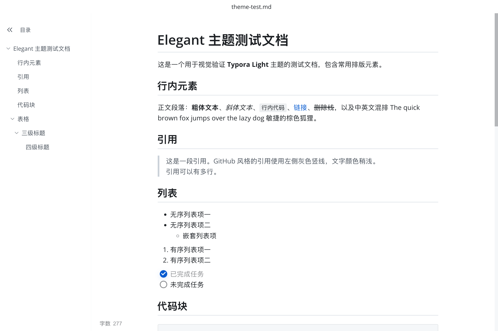
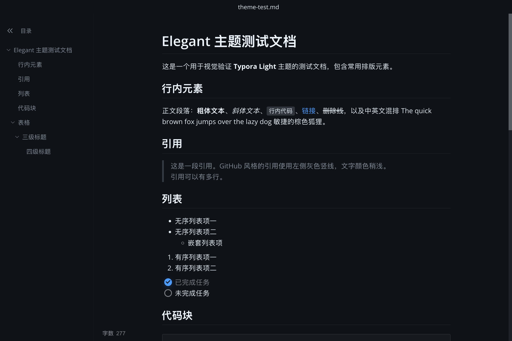

<p align="center"></p>

<h1 align="center">Elegant</h1>

<p align="center">
  <strong>A Typora-flavoured markdown editor built on the MarkText engine</strong><br>
  基于 MarkText 引擎、界面交互对齐 Typora 的所见即所得 Markdown 编辑器
</p>

---

> **Elegant** is a personal fork of [MarkText](https://github.com/marktext/marktext)
> (MIT License). The editor engine and the vast majority of the codebase come
> from MarkText — all credit goes to its contributors, see
> [LICENSE](LICENSE) for attribution. This repository only layers a
> Typora-inspired user interface on top and stays close to upstream for
> future syncing.

## 与 MarkText 的差异

Elegant 的改动集中在桌面层（`packages/desktop`），编辑内核 Muya 保持不动：

| 方面 | 变化 |
|---|---|
| 主题 | 新增 `elegant-light`（经典 GitHub Light 色板，默认）与 `elegant-dark`（GitHub Dark Default），跟随系统明暗自动切换 |
| 窗口形态 | Typora 式单窗口单文档：新文件/新文件夹默认开新窗口，隐藏标签页 |
| 标题栏 | 居中显示文件名（点击可重命名），移除路径面包屑 |
| 状态栏 | 字数统计位于编辑区左下角，点击循环切换指标（字数/段落/字符），悬停展开明细（选区计数、只读模式、文件信息） |
| 快捷键 | macOS 源码模式改为 `Cmd + /`（与 Typora 一致）；`Cmd+1..6` 标题、打字机/专注模式等本就与 Typora 相同 |
| 图片粘贴 | 默认复制到 `./assets` 并以相对路径引用 |
| 品牌与图标 | 更名 Elegant，原创应用图标（斜体衬线 e + 朱红「雅」印） |

## 截图

| elegant-light | elegant-dark |
|---|---|
|  |  |

## 从源码构建

环境要求：Node.js ≥ 22.12、pnpm ≥ 10（推荐用 corepack 管理）、Git。

```bash
git clone git@github.com:liupcmail/elegant.git
cd elegant
pnpm install          # 自动下载 Electron、编译原生模块
pnpm run dev          # 开发模式（渲染层热重载）
```

打包安装包（在对应平台的主机上执行）：

```bash
pnpm run build:mac    # macOS（arm64 / x64 可选）
pnpm run build:win    # Windows（x64 / arm64 可选）
pnpm run build:linux  # Linux
```

产物输出在仓库根目录 `dist/`。**构建未签名**：macOS 首次启动若被
Gatekeeper 拦截，执行 `xattr -cr /Applications/Elegant.app` 即可。

日常开发规范、目录结构与测试命令见 [AGENTS.md](AGENTS.md)。

## 与上游同步

上游 [marktext/marktext](https://github.com/marktext/marktext) 活跃维护中，建议偶尔合并：

```bash
git fetch upstream
git merge upstream/develop
```

所有 Elegant 改动都隔离在 `packages/desktop` 内，正常情况下冲突很少。

## 许可证

[MIT](LICENSE) — 含原始版权声明与 Elegant 修改版权。Muya 编辑引擎及绝大部分代码的著作权归 MarkText 贡献者所有。
